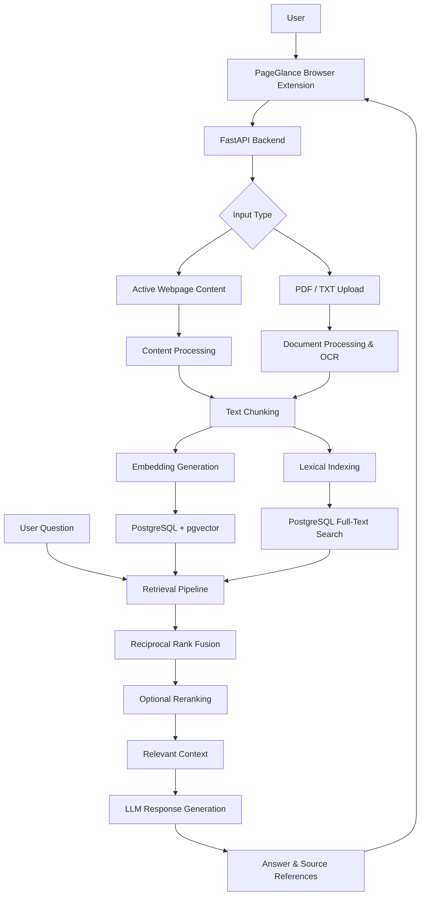
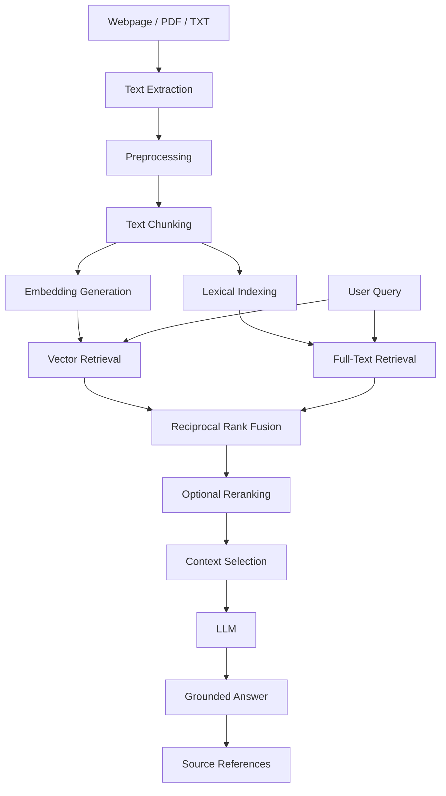

# 🧠 PageGlance

### An AI-Powered Browser Assistant for Context-Aware Webpage & Document Understanding

<p align="center">
  <a href="https://addons.mozilla.org/en-GB/firefox/addon/pageglance/"><strong>Firefox Add-on</strong></a> •
  <a href="https://github.com/anshh-py/PageGlance"><strong>GitHub Repository</strong></a> •
  <a href="https://ansh9057-pageglance-backend.hf.space"><strong>Backend API</strong></a>
</p>

<p align="center">
  
  
  
  
  
  
  
  
</p>

---

## Overview

**PageGlance** is an AI-powered browser assistant that enables users to understand, question, and explore information from webpages and documents through natural-language conversations.

Instead of manually searching through lengthy articles, navigating between sections, or repeatedly reading documents, users can ask questions directly about the content they are viewing.

PageGlance combines a browser extension with a Retrieval-Augmented Generation (RAG) backend to retrieve relevant context and generate answers grounded in the available source material.

The platform supports webpage question answering, PDF and TXT document ingestion, OCR-based text extraction, multi-document retrieval, and source-aware responses.

At its core, PageGlance is built around a **hybrid retrieval architecture** that combines semantic vector search with lexical full-text search, Reciprocal Rank Fusion (RRF), and optional reranking to improve the relevance of retrieved context before answer generation.

The project brings together browser-extension engineering, backend API development, document processing, vector databases, information retrieval, and LLM-powered response generation in one integrated application.

## Live Application & Resources

| Component | Resource |
|---|---|
| Firefox Add-on | [PageGlance on Mozilla Add-ons](https://addons.mozilla.org/en-GB/firefox/addon/pageglance/) |
| Backend API | [PageGlance Backend](https://ansh9057-pageglance-backend.hf.space) |
| GitHub Repository | [anshh-py/PageGlance](https://github.com/anshh-py/PageGlance) |
| GitHub Releases | [Download Releases](https://github.com/anshh-py/PageGlance/releases) |

> **Firefox availability:** The add-on submission has been sent to Mozilla and is awaiting review. Public installation availability depends on Mozilla's publication process.

---

## Key Features

### 🌐 Context-Aware Webpage Question Answering

- Ask natural-language questions about the currently active webpage.
- Extract relevant webpage content through the browser extension.
- Use page context to generate relevant, source-grounded responses.
- Avoid repeatedly copying and pasting article content into external AI tools.
- Maintain a conversational interface for exploring webpage information.

### 📄 PDF & TXT Document Intelligence

- Upload PDF and TXT documents for AI-assisted analysis.
- Extract text from supported document formats.
- OCR-based text extraction for scanned document content.
- Process and chunk documents for retrieval.
- Ask questions across multiple uploaded documents.
- Retrieve relevant passages instead of sending entire documents directly to the language model.

### 🔎 Hybrid Information Retrieval

PageGlance uses multiple retrieval strategies to improve the relevance of information supplied to the generation model.

- **Semantic vector search:** Retrieves contextually similar passages using embeddings.
- **Lexical search:** Uses PostgreSQL full-text search to identify keyword-relevant content.
- **Reciprocal Rank Fusion (RRF):** Combines rankings from multiple retrieval strategies.
- **Optional reranking:** Refines retrieved candidates before context construction.
- **Context-aware retrieval:** Selects relevant document passages for answer generation.

### 📚 Source-Grounded Answer Generation

- Generate answers using retrieved source material.
- Provide source references to help users trace relevant information.
- Keep retrieval and answer generation as separate stages.
- Support evidence-based responses rather than relying exclusively on the model's parametric knowledge.

### 🧠 Retrieval-Augmented Generation (RAG)

- Document ingestion and preprocessing pipeline.
- Text chunking and embedding generation.
- Persistent vector storage using PostgreSQL and pgvector.
- Hybrid retrieval and context assembly.
- LLM-powered answer generation using retrieved context.

### 📊 Observability & Tracing

- LangSmith integration for tracing supported LLM workflows.
- Visibility into retrieval and generation execution.
- Easier inspection of intermediate pipeline behavior.
- Support for debugging and iterative RAG development.

### ⚡ Browser Extension Architecture

- React-based extension interface.
- TypeScript application logic.
- Vite-based development and production builds.
- Dedicated browser-specific production packaging.
- Chrome and Firefox build targets.
- Backend communication through a deployed FastAPI service.

---

## System Architecture

PageGlance follows a modular architecture that separates the browser interface, API layer, document-processing pipeline, retrieval system, and language-model generation.



### Architecture Highlights

- **Browser Extension:** Captures webpage context and provides the conversational user interface.
- **FastAPI Backend:** Handles requests, document workflows, retrieval orchestration, and response generation.
- **Document Processing:** Extracts and prepares content from webpages, PDFs, and TXT files.
- **Embedding Pipeline:** Converts text chunks into vector representations for semantic retrieval.
- **PostgreSQL + pgvector:** Stores document data, chunks, and vector embeddings.
- **Lexical Retrieval:** Uses PostgreSQL full-text search to retrieve keyword-relevant passages.
- **RRF:** Combines results from semantic and lexical retrieval.
- **Reranking:** Optionally improves the ordering of retrieved candidates.
- **LLM Generation:** Produces responses using the retrieved context.
- **LangSmith:** Supports tracing and inspection of AI workflows.

---

## Retrieval-Augmented Generation Pipeline

The RAG pipeline is the central component of PageGlance.

Rather than passing an entire webpage or document directly to a language model, PageGlance processes the source material, retrieves relevant passages, and constructs context for answer generation.



### Retrieval Strategy

| Stage | Technique | Purpose |
|---|---|---|
| Preprocessing | Text extraction and normalization | Prepare source content |
| Chunking | Document segmentation | Create retrievable passages |
| Embeddings | Dense vector representations | Capture semantic similarity |
| Semantic Retrieval | pgvector similarity search | Find contextually relevant chunks |
| Lexical Retrieval | PostgreSQL full-text search | Find keyword-relevant chunks |
| Fusion | Reciprocal Rank Fusion | Combine retrieval rankings |
| Reranking | Optional reranker | Refine candidate relevance |
| Generation | LLM-based synthesis | Produce an answer from retrieved context |

### Why Hybrid Retrieval?

Vector search and lexical search solve different retrieval problems.

Semantic search can retrieve conceptually related passages even when the wording differs. Lexical search can identify exact terminology, names, technical phrases, and keywords.

Combining both strategies through RRF provides a retrieval architecture that uses complementary relevance signals instead of depending on a single search method.

---

## Multi-Document Retrieval

PageGlance supports querying information across multiple uploaded documents.

The document workflow includes:

1. Uploading supported PDF and TXT files.
2. Extracting document text, including OCR-based extraction where applicable.
3. Splitting content into manageable chunks.
4. Generating embeddings for retrieval.
5. Persisting document and chunk information.
6. Retrieving relevant passages across the available document collection.
7. Generating answers from retrieved context.

This makes PageGlance useful for exploring collections of notes, reports, technical documents, and other text-based resources.

---

## Technology Stack

| Category | Technologies |
|---|---|
| Programming Languages | Python, TypeScript, JavaScript |
| Browser Extension | React, TypeScript |
| Frontend Build Tool | Vite |
| Backend Framework | FastAPI |
| API Architecture | REST APIs |
| Database | PostgreSQL |
| Vector Search | pgvector |
| Semantic Retrieval | Embeddings |
| Lexical Retrieval | PostgreSQL Full-Text Search |
| Retrieval Fusion | Reciprocal Rank Fusion (RRF) |
| Reranking | Optional reranking pipeline |
| Document Processing | PDF and TXT extraction, OCR |
| AI Integration | LLM-based generation |
| Observability | LangSmith |
| Database Migrations | Alembic |
| Backend Hosting | Hugging Face Spaces |
| Database Hosting | Neon PostgreSQL |
| Version Control | Git, GitHub |

---

## Database & Vector Storage

PageGlance uses PostgreSQL as its persistent data layer, with pgvector providing vector similarity search.

The database supports the storage and retrieval of document-related information, including text chunks and their corresponding embeddings.

### Database Responsibilities

- Persistent document storage.
- Text chunk management.
- Vector embedding storage.
- Semantic similarity retrieval.
- PostgreSQL full-text search.
- Schema evolution through Alembic migrations.

### Vector Retrieval

Embeddings represent text chunks as numerical vectors. When a user submits a question, the retrieval pipeline uses vector similarity to identify passages that are semantically related to the query.

The vector retrieval results are combined with lexical retrieval results to create a more comprehensive candidate set.

---

## Backend API

PageGlance uses FastAPI to expose backend functionality through HTTP APIs.

The backend handles communication between the browser extension and the RAG pipeline, including content processing, document ingestion, retrieval, and answer generation.

**Backend:** [PageGlance FastAPI Service](https://ansh9057-pageglance-backend.hf.space)

API documentation, where enabled:

- `/docs` — Swagger UI
- `/openapi.json` — OpenAPI schema

### Backend Responsibilities

- Browser extension communication.
- Webpage content processing.
- PDF and TXT ingestion.
- OCR-based document processing.
- Embedding generation.
- Hybrid retrieval orchestration.
- Context construction.
- LLM response generation.
- Source-aware response handling.

---

## Project Structure

PageGlance separates browser-extension code, backend services, and supporting infrastructure.

```text
PageGlance/
│
├── extension/
│   ├── src/
│   │   ├── components/
│   │   ├── services/
│   │   └── ...
│   │
│   ├── public/
│   ├── scripts/
│   │   ├── pack-firefox.mjs
│   │   └── verify-firefox-zip.mjs
│   │
│   ├── package.json
│   └── vite.config.ts
│
├── backend/
│   ├── app/
│   │   ├── api/
│   │   ├── services/
│   │   ├── retrieval/
│   │   ├── ingestion/
│   │   ├── database/
│   │   └── ...
│   │
│   ├── alembic/
│   ├── tests/
│   └── requirements.txt
│
├── README.md
└── ...
```

> The directory tree is a high-level representation. Refer to the repository for the current implementation and exact module names.

---

## Getting Started

Follow these steps to set up PageGlance locally.

### Prerequisites

- Python
- Node.js and npm
- PostgreSQL database with pgvector support
- Required LLM and embedding provider credentials
- A Chromium-based browser or Firefox for extension testing

### 1. Clone the Repository

```bash
git clone https://github.com/anshh-py/PageGlance.git
cd PageGlance
```

### 2. Set Up the Backend

Create a virtual environment:

**Windows**

```bash
python -m venv .venv
.venv\Scripts\activate
```

**Linux / macOS**

```bash
python -m venv .venv
source .venv/bin/activate
```

Install backend dependencies:

```bash
pip install -r backend/requirements.txt
```

### 3. Configure Backend Environment Variables

Create a local environment file using the repository's example configuration, if provided.

Configure the required values for:

- PostgreSQL database connection.
- LLM provider credentials.
- Embedding model/provider configuration.
- Any optional observability integrations.

Use the actual variable names documented in the backend configuration and environment example.

Never commit `.env` files, API keys, database passwords, or other secrets.

### 4. Configure the Database

Ensure PostgreSQL and pgvector are available.

Run the project's Alembic migrations using the repository's configured migration workflow.

```bash
cd backend
alembic upgrade head
```

### 5. Start the Backend

From the backend directory, use the application's configured FastAPI entry point:

```bash
uvicorn app.main:app --reload
```

The local API will be available at:

```text
http://127.0.0.1:8000
```

### 6. Set Up the Browser Extension

Open a separate terminal:

```bash
cd extension
npm ci
```

Configure the extension's production or development API URL using the documented Vite environment variable:

```text
VITE_PAGEGLANCE_API_URL
```

For local backend development, the value should point to:

```text
http://127.0.0.1:8000
```

Keep private environment files out of version control.

### 7. Build the Extension

Use the browser-specific build scripts defined in `extension/package.json`.

```bash
npm run build
```

For Firefox, use the dedicated Firefox build and packaging scripts:

```bash
npm run build:firefox
npm run pack:firefox
npm run verify:firefox
```

> Run the exact scripts available in the current package configuration. Browser-specific build commands may differ by target.

### 8. Load the Extension Locally

**Chrome / Chromium**

1. Open `chrome://extensions`.
2. Enable Developer mode.
3. Select Load unpacked.
4. Select the generated Chrome build directory.

**Firefox**

1. Open `about:debugging#/runtime/this-firefox`.
2. Select Load Temporary Add-on.
3. Select the generated Firefox `manifest.json`.

---

## Deployment Architecture

PageGlance uses a separated deployment architecture for the browser client, API service, and persistent database.

| Component | Platform | Responsibility |
|---|---|---|
| Browser Extension | Chrome / Firefox | User interface and webpage context |
| Backend API | Hugging Face Spaces | FastAPI application and RAG orchestration |
| Database | Neon PostgreSQL | Persistent data and vector storage |
| Vector Search | pgvector | Semantic retrieval |
| Observability | LangSmith | LLM workflow tracing |

**Production backend:**  
https://ansh9057-pageglance-backend.hf.space

The browser extension communicates with the deployed backend through its configured API endpoint. Database operations and retrieval orchestration remain on the backend.

---

## Engineering Highlights

PageGlance demonstrates practical implementation of several software engineering and AI concepts:

- Designing a browser extension with React and TypeScript.
- Building REST APIs using FastAPI.
- Implementing a document ingestion and preprocessing pipeline.
- Working with PDF/TXT extraction and OCR.
- Designing a Retrieval-Augmented Generation architecture.
- Implementing semantic vector retrieval using pgvector.
- Integrating PostgreSQL full-text search.
- Combining retrieval rankings using Reciprocal Rank Fusion.
- Integrating optional reranking into the retrieval pipeline.
- Building multi-document retrieval workflows.
- Generating source-grounded responses from retrieved context.
- Managing persistent vector data with PostgreSQL.
- Handling database schema evolution with Alembic.
- Integrating LangSmith for observability and tracing.
- Building and packaging browser-specific extension releases.
- Deploying a cloud-hosted backend service.

---

## Release & Distribution

PageGlance provides browser-specific production builds.

| Browser | Distribution |
|---|---|
| Chrome | [GitHub Releases](https://github.com/anshh-py/PageGlance/releases) |
| Firefox | [Mozilla Add-ons Listing](https://addons.mozilla.org/en-GB/firefox/addon/pageglance/) |

The Firefox extension has been submitted to Mozilla Add-ons for review. Its public availability is subject to Mozilla's review and publication process.

For versioned builds and release notes, visit the [GitHub Releases](https://github.com/anshh-py/PageGlance/releases) page.

---
**Connect:**

- GitHub: [@anshh-py](https://github.com/anshh-py)
- Project: [PageGlance](https://github.com/anshh-py/PageGlance)

---

<p align="center">
  <strong>PageGlance — Understand more. Search less. Ask better questions.</strong>
</p>
