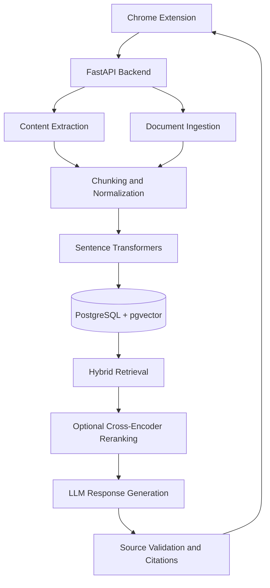

# PageGlance

**Ask questions about webpages and documents, backed by retrieval-augmented generation.**

PageGlance is a Chrome extension with a FastAPI backend that lets users ask questions about webpage content and uploaded PDF or text documents. It combines local semantic embeddings, PostgreSQL-based retrieval, and LLM-generated responses with source citations.

## Architecture



## Core Capabilities

- **Context-aware chat:** Ask questions about the active webpage or selected documents, with support for follow-up questions and streaming responses.
- **Retrieval-augmented generation:** Retrieve relevant chunks using semantic vector search and PostgreSQL full-text search, combined through Reciprocal Rank Fusion.
- **Local embeddings:** Generate 384-dimensional embeddings using Sentence Transformers without relying on a hosted embedding API.
- **Document ingestion:** Process PDF and TXT uploads, including OCR for scanned PDF pages, with bounded processing limits.
- **Source grounding:** Associate answers with retrieved sources and reject unsupported or invalid citations.
- **Persistent retrieval:** Store document chunks, embedding metadata, and retrieval data in PostgreSQL with pgvector.
- **Retrieval evaluation:** Compare retrieval strategies using Recall@K, MRR, nDCG, citation recall, scope checks, and latency.

## Technology Stack

| Layer | Technologies |
|---|---|
| Extension | React, TypeScript, Vite, Chrome Extension Manifest V3 |
| API | Python, FastAPI, Pydantic |
| LLM | Groq API |
| Embeddings | Sentence Transformers, all-MiniLM-L6-v2 |
| Retrieval | Vector search, PostgreSQL full-text search, RRF |
| Reranking | Sentence Transformers CrossEncoder |
| Persistence | PostgreSQL, SQLAlchemy, pgvector, Alembic |
| Quality | Pytest, ESLint, retrieval evaluation |

## Engineering Design

### Retrieval pipeline

Documents and webpages are normalized, split into chunks, and embedded using a shared embedding pipeline. Retrieval combines vector similarity with lexical search to improve coverage across natural-language questions and exact terms.

An optional cross-encoder reranks candidate passages. Retrieved evidence is scoped to the active webpage or explicitly selected documents before being passed to the generation layer.

### Reliability and safety

- Bounded input sizes, document processing, and retrieval candidates.
- URL normalization and page-scoped retrieval to reduce cross-page contamination.
- Validation of generated source references against retrieved evidence.
- Fallback behavior when retrieval is unavailable or evidence is insufficient.
- Database migrations and automated tests for ingestion, retrieval, API behavior, and persistence.

### Evaluation

The repository includes a versioned retrieval evaluation dataset and a reproducible evaluation runner. It measures retrieval quality and latency across vector-only, lexical-only, and fused retrieval.

The evaluation is intended as a regression baseline; results on a small labeled dataset should not be interpreted as proof of production-wide answer accuracy.

## Local Development

### Prerequisites

- Python 3.11 or a compatible version supported by the backend dependencies
- Node.js and npm
- PostgreSQL with pgvector
- A Groq API key
- Tesseract OCR for scanned PDF support

### Backend

Install the backend and development dependencies in a virtual environment, configure the required runtime settings, apply the database migrations, and start the API:

```powershell
cd backend
py -3 -m venv .venv
.\.venv\Scripts\Activate.ps1
pip install -e ".[dev]"
alembic upgrade head
uvicorn app.main:app --reload
```

The API is available at `http://127.0.0.1:8000`, with interactive documentation at `/docs`.

### Chrome Extension

```powershell
cd extension
npm install
npm run lint
npm test
npm run build
```

Open `chrome://extensions`, enable Developer mode, and load the generated `extension/dist` directory using **Load unpacked**.

### Testing

Run the backend test suite from the backend directory:

```powershell
python -m pytest -q
```

PostgreSQL integration tests are opt-in and require a dedicated disposable test database.

## Project Structure

```text
PageGlance/
├── backend/
│   ├── app/             # API, ingestion, embeddings and retrieval
│   ├── migrations/      # Database schema migrations
│   ├── tests/           # Unit and integration tests
│   └── evals/           # Retrieval evaluation dataset and runner
├── extension/
│   └── src/             # Extension UI and client-side logic
└── README.md
```

## Current Scope

PageGlance supports webpage question answering and retrieval over uploaded text and PDF documents. Retrieval evaluation currently focuses on a small labeled dataset. Production deployment, authentication, multi-user data isolation, and broader answer-quality evaluation remain separate engineering concerns.

## License

No license has been specified yet.
