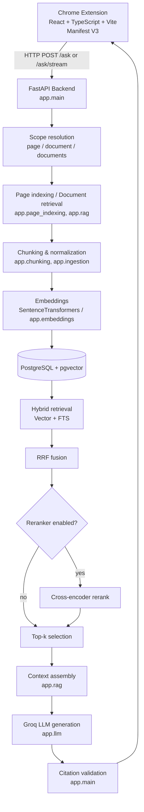

# PageGlance

**Chrome extension + FastAPI backend for asking questions about webpages and uploaded documents with retrieval-grounded answers and citations.**

PageGlance is a personal portfolio project that combines a Chrome Extension (Manifest V3) with a FastAPI backend to perform scoped RAG over the active webpage or uploaded PDFs/TXT files. It uses local embeddings, PostgreSQL + pgvector, hybrid retrieval (vector + PostgreSQL FTS) with Reciprocal Rank Fusion, optional cross-encoder reranking, Groq for generation, and source-grounding with citations.

## Problem it solves

Users want to ask questions about content they're looking at without manually searching or copying context. PageGlance indexes the active webpage or uploaded documents into a scoped knowledge base and returns answers grounded in retrieved evidence with citations.

## Key features

- **Scoped chat**: Ask about the active webpage or explicitly selected uploaded document(s) (single or up to 5 documents).
- **Streaming responses**: `/ask/stream` returns Server-Sent Events (`sources`, `token`, `replace`, `done`, `error`).
- **RAG with grounding**: Answers are validated against retrieved sources; missing/invalid citations trigger abstention when evidence is insufficient.
- **Hybrid retrieval**: Vector similarity (pgvector) + PostgreSQL full-text search (simple config) fused with Reciprocal Rank Fusion (RRF). Optional cross-encoder reranking.
- **Local embeddings**: `sentence-transformers/all-MiniLM-L6-v2` (384-dim) by default; legacy OpenAI embeddings path supported via configuration.
- **Document ingestion**: Upload TXT/PDF with OCR for scanned PDFs (PyMuPDF + pytesseract), chunking with overlap, bounded limits.
- **Observability**: LangSmith tracing integrated (opt-in via env vars).
- **Evaluation**: Retrieval evaluation suite and Ragas evaluation scaffolding for the four metrics.

## Architecture



## Technology stack (actual)

| Layer | Technologies |
|---|---|
| Extension | React, TypeScript, Vite, Chrome Manifest V3 |
| Backend API | FastAPI, Pydantic, Uvicorn |
| LLM | Groq API (via `groq` SDK) |
| Embeddings | `sentence-transformers` (`all-MiniLM-L6-v2`, 384-dim) |
| Retrieval | pgvector cosine similarity, PostgreSQL full-text search (simple regconfig), RRF, optional `cross-encoder/ms-marco-MiniLM-L-6-v2` |
| Storage | PostgreSQL, SQLAlchemy 2.x, pgvector, Alembic |
| Document processing | PyPDF/pypdf, PyMuPDF, pytesseract, Pillow |
| Tracing/Eval | LangSmith SDK, Ragas, datasets, pytest |

## How the extension and backend communicate

- The Chrome extension sends JSON to the FastAPI backend over HTTP (same-origin/CORS configured in `app.main`).
- Endpoints: `POST /ask` (JSON response with `answer` and optional `sources`), `POST /ask/stream` (SSE). Additional endpoints for document upload/stats/health.
- Requests include `question`, scope (`page`, `document_id`, or `document_ids`), and optional `history`. The backend scopes retrieval to the provided scope and returns citations referencing retrieved chunks/sources.

## RAG workflow (as implemented)

1. **Ingestion/indexing**: Page content extracted by extension or uploaded files ingested via `app.document_ingestion`. Text normalized/chunked (`app.chunking`), embedded (`app.embedding_pipeline`), stored in Postgres with pgvector columns (local 384-dim profile for sentence-transformers).
2. **Query transformation**: Adaptive query splitting/retry logic in `app.rag` for multi-part questions or pronoun resolution.
3. **Retrieval**: `app.retrieval.VectorRetriever` performs vector search and/or lexical (FTS) search with scope filters applied first. Hybrid retrieval runs both paths and fuses via RRF (`fuse_rankings`). Optional reranking with cross-encoder when enabled.
4. **Context assembly**: `app.rag.RagOrchestrator` merges results, builds `retrieved_sources` with citation IDs (`S1`, `S2`, ...), falls back to page context if retrieval yields nothing/insufficient evidence.
5. **Generation**: `app.llm` builds grounded system/user messages and calls Groq Chat Completions. Streaming via `stream_answer()` with async generator.
6. **Citations & validation**: `app.main._validate_grounded_answer` ensures factual claims cite valid retrieved source IDs (or `P` for page) when RAG evidence is used; returns abstention if evidence insufficient.

## API endpoints (actual)

| Method | Path | Description |
|---|---|---|
| `GET` | `/health` | Health check |
| `GET` | `/documents/{document_id}/stats` | Indexed chunk stats for a document (no full text) |
| `POST` | `/documents/upload` | Upload TXT/PDF for ingestion/indexing |
| `POST` | `/ask` | Synchronous answer with citations |
| `POST` | `/ask/stream` | SSE streaming answer (`sources`, `token`, `replace`, `done`, `error`) |

See `backend/app/main.py` for request/response schemas and validation.

## LangSmith tracing

Tracing is integrated via the standalone `langsmith` SDK. It is **opt-in** and **disabled** if not configured.

**Environment variables (from `.env.example` context):**
- `LANGSMITH_TRACING` (true/false)
- `LANGSMITH_API_KEY`
- `LANGSMITH_PROJECT` (default `pageglance`)
- `LANGSMITH_ENDPOINT` (optional)

**Configuration:** `backend/app/langsmith_tracing.py` configures tracing and provides helpers; `backend/app/main.py` adds tracing hooks around request/LLM/citation steps. When disabled or credentials missing, tracing is a no-op with no secrets logged.

## Ragas evaluation

**Metrics (configured):** Faithfulness, AnswerRelevancy, ContextPrecision, ContextRecall (using `ragas` with Groq LLM and PageGlance embeddings).

**Dataset:** `backend/evals/rag_eval_v2.json` (version `rag-eval-v2`, 22 cases, 16 corpus entries). Do not replace this file.

**Scripts:** `backend/evals/run_ragas_eval.py` (uses actual pipeline via `app.evaluation_interface.capture_rag_sample()`), retrieval eval in `backend/evals/run_retrieval_eval.py`.

**Running evaluation (example):**
```bash
cd backend
# set GROQ_API_KEY in env
.\.venv\Scripts\python.exe -c "from evals import run_ragas_eval; r,j = run_ragas_eval.run(max_cases=3, exclude_unsupported=True, report_prefix='ragas_eval_3cases'); print(r['metrics'])"
```
Reports written to `backend/evals/reports/` with distinct filenames for limited runs. 

**Important:** Mocked tests demonstrate plumbing; live evaluation results depend on API availability/rate limits. This README does **not** claim specific benchmark scores - any real results should be reported from actual runs only.

## Installation and local setup (Windows)

### Prerequisites
- Python 3.10+
- Node.js/npm
- PostgreSQL with pgvector
- Groq API key
- Tesseract OCR (for scanned PDFs)

### Backend setup
```bash
cd backend
python -m venv .venv
.\.venv\Scripts\activate
pip install -e ".[dev]"
cp ../.env.example ../.env  # configure as needed
# Run migrations
alembic upgrade head
# Start server
python -m uvicorn app.main:app --host 127.0.0.1 --port 8000
# Or use Start_PageGlance.bat from repo root
```

### Extension setup
```bash
cd extension
npm install
npm run dev  # or build
# Load unpacked extension in Chrome from extension/dist or source as configured
```

### Environment variables
Copy `.env.example` to `.env` and configure. See `.env.example` for all variables (keys redacted in examples). Never commit real API keys.

## Repository structure (actual, excluding venv/caches/secrets)

```
pageglance/
+-- backend/
¦   +-- app/           # FastAPI app, RAG, retrieval, LLM, embeddings, ingestion
¦   +-- alembic/       # migrations
¦   +-- evals/         # evaluation datasets and runners
¦   +-- tests/         # pytest tests
¦   +-- pyproject.toml
+-- extension/         # Chrome extension (React/TS/Vite)
+-- Start_PageGlance.bat
+-- .env.example
+-- README.md
```

## Known limitations

- Personal portfolio project, not production-ready
- Groq API rate limits can affect live evaluation/generation
- OCR requires local Tesseract installation
- Local embeddings model download on first use
- Some features depend on PostgreSQL + pgvector being available

## Future improvements

- Expand evaluation coverage
- Improve error handling and observability
- Additional retrieval strategies
- Better document type support
